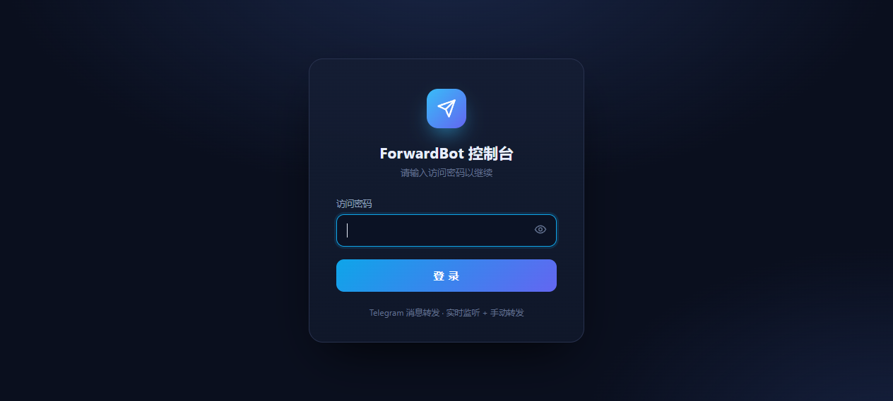
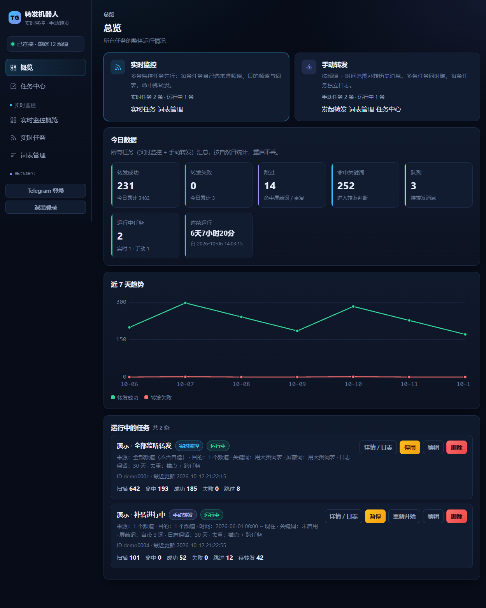
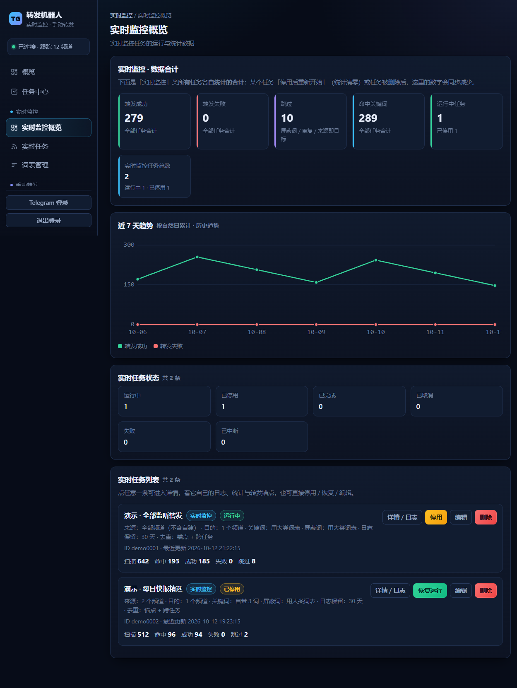
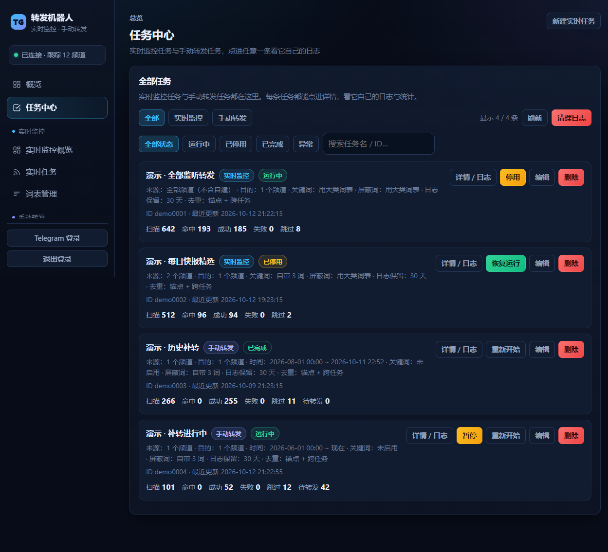
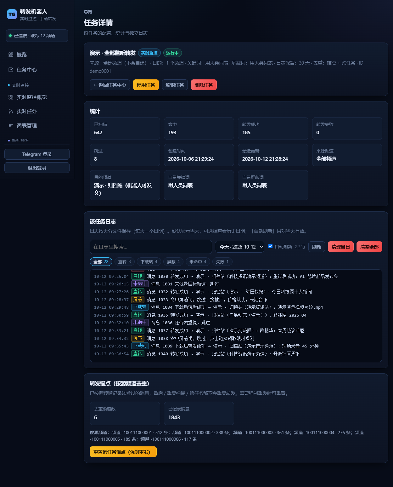
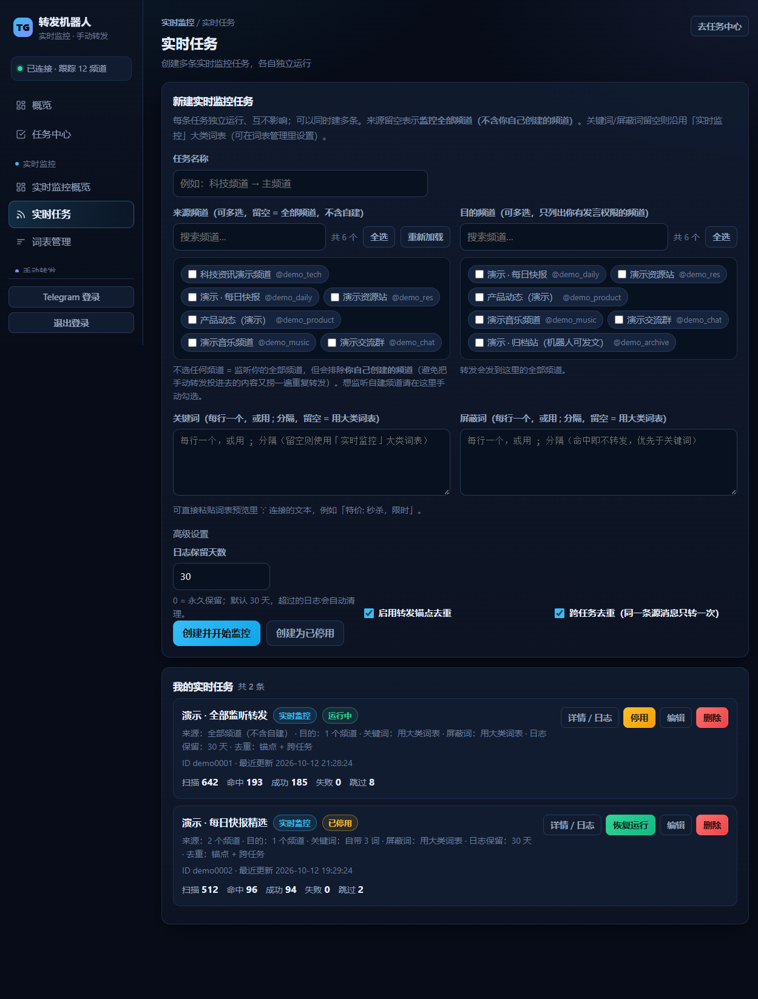
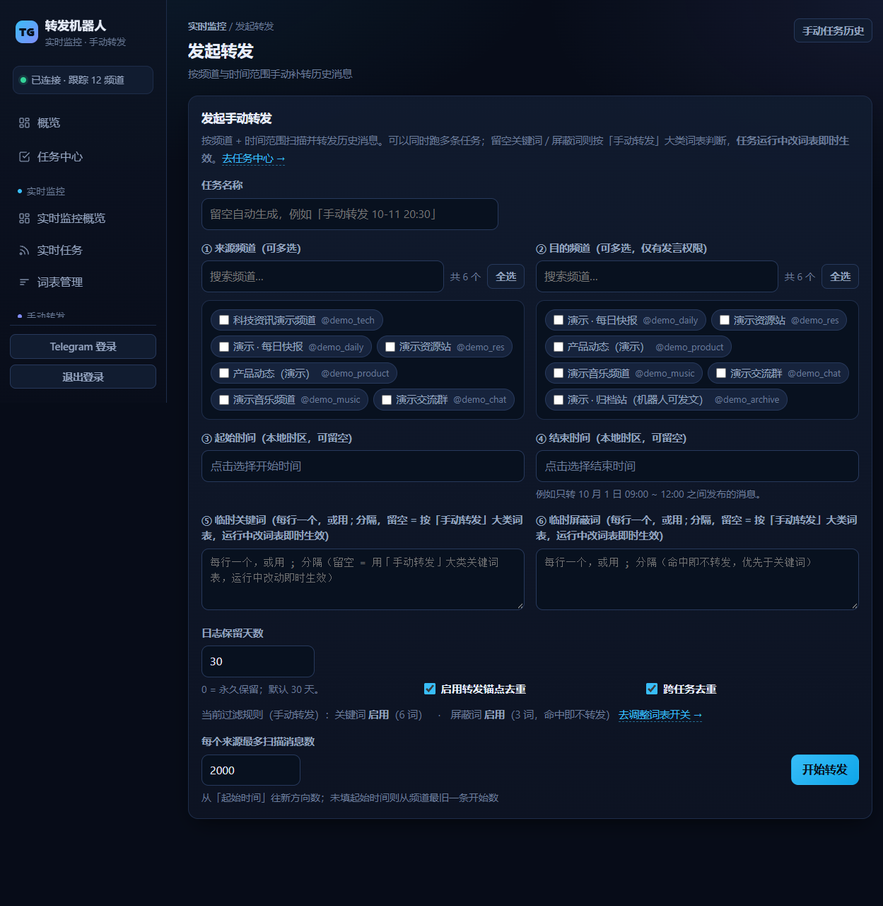
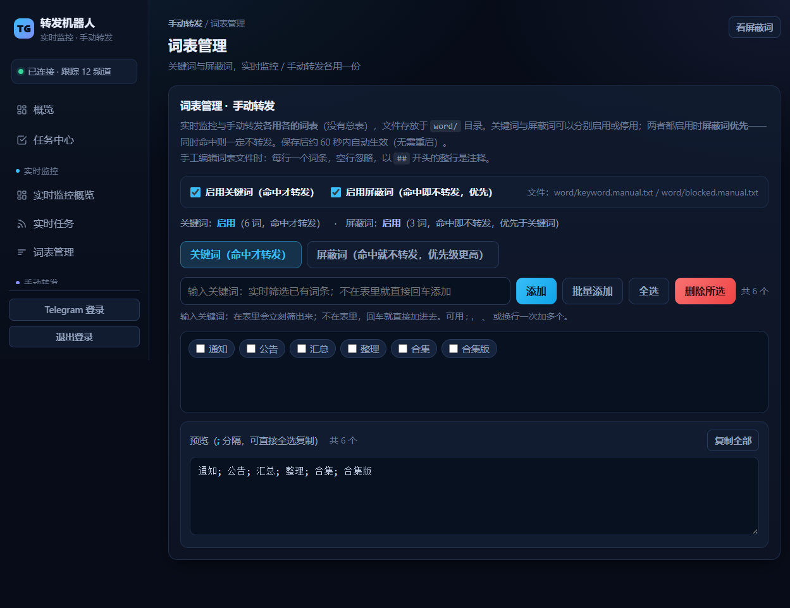

# TG Forward Bot · Telegram 消息转发机器人

> 一个自托管的 Telegram 消息转发机器人：**实时监听转发 + 手动历史转发**，多任务并行、可视化 Web 管理台、按源频道锚点去重、分大类词表过滤。

基于 [Telethon](https://codeberg.org/Lonami/Telethon) + [aiohttp](https://docs.aiohttp.org/) + SQLite，纯 Python，无需额外框架，一条命令即可部署。

---

## ✨ 功能特性

### 转发能力

- **实时监控转发**：监听 Telegram 新消息，命中规则即转发到指定目的频道；支持同时运行**多条**实时任务，各自独立的来源/目的/词表/开关。
- **手动历史转发**：按「频道 + 时间范围」补转历史消息，适合建频道后一次性搬运；可**暂停 / 恢复 / 编辑 / 取消 / 重新开始**（重新开始 = 清空该任务进度，从头重发一遍）。
- **多任务并行**：实时与手动两大类均可同时跑多条任务，互不干扰。
- **转发锚点去重**：按**源频道**记录已转发位置（水位锚点），防止重复转发；支持「任务级去重」与「跨任务去重（同一条源消息只转一次）」。
- **无限重试**：网络不稳、Telegram 偶发断连时，单条消息会**一直重试**（退避最长 60 秒）而不是悄悄丢弃；受保护频道的媒体会自动降级为「下载到本机再上传」。
- **断点续跑**：手动转发会把「待转发队列 + 当前进度」落盘，**暂停 / 服务重启 / 断电后都能从断点接着转**，不会重新扫描已处理的部分；服务重启时未跑完的任务会**自动恢复**（你自己点过「暂停」的除外）。
- **断线补扫**：网络断开重连后自动补扫断线期间遗漏的消息。

### 日志

- **一任务一文件夹、一天一文件**：`log/tasks/<任务ID>/YYYY-MM-DD.log`，网页默认显示当天，可下拉切换历史日期。
- **按类别筛选**：每条日志带类别徽章，可直接筛出
  - **直转** —— 直接转发成功（媒体引用重发，全程不落盘）
  - **下载转** —— 下载到本机后重新上传成功
  - **屏蔽** —— 命中屏蔽词未转发
  - **未命中** —— 不算错但没转发（已转发过 / 任务内重复 / 来源即目标）
  - **失败** —— 取回失败 / 消息已不可用 / 任务异常
- **清理**：任务详情可**清理当日日志**，任务中心可**清空全部日志**；每条任务还能设「日志保留天数」，过期自动清。

### 过滤规则

- **关键词 / 屏蔽词**：可全局（按大类）配置，也可为单条任务单独指定。
- **屏蔽词优先**：同时命中关键词与屏蔽词 → 不转发。
- **批量录入**：词表支持按 `;` `,` `，` `、` 换行 批量粘贴；任务表单里同样支持用 `;` 分隔，可直接从词表预览复制粘贴。
- **词表分离**：`实时监控` 与 `手动转发` **各用各的**关键词表 / 屏蔽词表，并各自带「启用关键词 / 启用屏蔽词」开关。

### Web 管理台

- 深色主题的单页控制台，顶部导航按「实时监控 / 手动转发」两大类分组。
- 各自独立的**概览**：统计卡片 + 7 日趋势图 + 状态分布 + 任务列表。
- **任务中心**：统一查看 / 暂停 / 恢复 / 编辑 / 删除所有任务，可点进**任务详情**看独立日志与锚点。
- **查看 / 编辑双模式**：查看页只显统计 + 日志 + 锚点，编辑页只显表单，互不干扰。
- **频道选择**：可搜索 + 勾选的频道列表（与词表体验一致）。
- **自写日期时间选择器**：不依赖浏览器原生控件，内嵌 WebView 也能用。
- **日志保留策略**：每条任务可设日志保留天数（默认 30 天，0 = 永久），过期自动清理。
- **内嵌 MiSans 字体**：前端字体随项目内置（`ui/fonts/`），离线 / 内网环境同样正常显示，不依赖外部 CDN。
- 鉴权：Basic Auth / Cookie 双支持，未登录时可从管理台直接跳转完成 Telegram 登录。

---

## 📸 界面截图

> 以下截图来自本地演示环境，数据均为示例数据。

| 登录 | 总览 |
|---|---|
|  |  |

| 实时监控概览 | 任务中心 |
|---|---|
|  |  |

| 任务详情 · 日志 | 新建实时任务 |
|---|---|
|  |  |

| 手动转发 | 词表管理 |
|---|---|
|  |  |

---

## 🧱 架构与模块

单体拆分为 9 个模块，职责单一、便于维护：

| 模块           | 职责                                                               |
| ------------ | ---------------------------------------------------------------- |
| `main.py`    | 入口：读配置 → 组装 → 启动 / 优雅退出                                          |
| `core.py`    | 公共基础：路径常量、时间戳打印、JSON 响应、文本切分（含 `;` 分隔的 `split_words`）            |
| `words.py`   | 词表：按大类分文件的关键词/屏蔽词 + 开关 + `/api/words*`                           |
| `tasks.py`   | 任务中心底座：任务表、**每任务日志（按天分文件 + 类别标记）**、**转发锚点**、任务/锚点接口              |
| `stats.py`   | 统计：全局 + 按大类（实时/手动）的按天计数                                          |
| `monitor.py` | 【实时监控】多任务并行运行 + 接口                                               |
| `manual.py`  | 【手动转发】按频道+时间范围补转（两阶段：先扫描入队 → 再逐条转发）+ 暂停/恢复（断点续跑）/编辑/取消/重新开始 + 接口 |
| `bot.py`     | 转发核心：Telegram 客户端、登录、消息投递（无限重试 + 受保护媒体降级为下载重传）、事件监听、断线补扫、日志清理    |
| `web.py`     | Web 管理台：鉴权、登录页、概览/日志/频道接口，汇总各模块路由                                |

前端拆分为 `ui/` 下的结构片段 + 样式 + 逻辑（由 `web.py` 运行时拼装，带 ETag/Cache-Control 缓存）：

```
ui/
├── head.html / tail.html        # 外壳（doctype/侧边栏/顶栏 + 收尾脚本）
├── view-dashboard*.html         # 总览 / 实时概览 / 手动概览
├── view-tasks.html              # 任务中心
├── view-taskdetail.html         # 任务详情（查看/编辑双模式）
├── view-monitor.html            # 新建实时任务
├── view-manual.html             # 发起手动转发
├── view-words.html              # 词表管理
├── login.html                   # 登录页
├── admin.css                    # 全部样式
├── admin.js                     # 全部前端逻辑
└── fonts/                       # 内嵌 MiSans 网页字体（离线可用）
```

数据（运行时自动创建）：`data/tasks.db`（任务）、`data/stats.db`（统计）、`data/anchors.db`（锚点）、`data/recovery_cursors.db`（频道游标）、`data/word_scopes.json`（词表开关）。

日志按「一任务一文件夹、一天一文件」存放，方便按天查看与清理：

```
log/
├── forward.log                 # 连接 / 全局日志
└── tasks/
    └── <任务ID>/
        ├── 2026-10-12.log      # 该任务当天的日志（带类别标记）
        └── <任务ID>.queue      # 待转发队列，断点续跑用；任务完成后自动删除
```

词表集中存放在 **`word/`** 目录（`keyword.monitor.txt` / `blocked.monitor.txt` / `keyword.manual.txt` / `blocked.manual.txt`）：

- **格式**：每行一个词条，空行忽略，**以 `##` 开头的整行是注释**；单个 `#` 开头视为普通词条（例如 `#tag`）。
- 平时**无需手动改文件**——在网页「词表管理」里增删即可；旧版散落在项目根目录的词表会在首次启动时**自动迁移**到 `word/`。

---

## 🚀 快速开始（一键安装）

在 **Debian / Ubuntu**（或其它带 systemd 的 Linux）上，以 root 执行：

```bash
git clone https://github.com/runishiwo/tgforwardbot.git
cd tgforwardbot
sudo bash install.sh
```

脚本会：

1. 安装 `python3 / venv / pip`（如缺失）；
2. 把项目复制到 `/opt/tgforwardbot`；
3. 创建虚拟环境并安装依赖；
4. 交互式询问 `api_id / api_hash / 管理台密码`，生成 `config.yml`；
5. 注册并启动 systemd 服务 `tgforwardbot`。

完成后按提示访问 `http://<服务器IP>:8080` 即可。

### 前置：获取 Telegram API 凭据

前往 <https://my.telegram.org> → 登录 → **API development tools** → 记下 `api_id` 与 `api_hash`。  
（这是你个人账号的开发者凭据，请妥善保管、勿泄露。）

### 非交互式安装（可选）

```bash
sudo TG_API_ID=123456 \
     TG_API_HASH=your_api_hash \
     TG_WEB_PASSWORD=your_password \
     TG_WEB_PORT=8080 \
     bash install.sh
```

可用环境变量：`INSTALL_DIR`、`TG_API_ID`、`TG_API_HASH`、`TG_WEB_PORT`、`TG_WEB_PASSWORD`、`TG_TARGET_ENTITY`、`SERVICE_NAME`、`NO_SYSTEMD`。

---

## 🛠 手动安装

```bash
# 1. 依赖
python3 -m venv venv
./venv/bin/pip install -r requirements.txt

# 2. 配置
cp config.example.yml config.yml
vi config.yml      # 填写 api_id / api_hash / web_password

# 3. 首次登录 Telegram（前台跑一次，按提示输入手机号/验证码/二步密码）
./venv/bin/python main.py

# 4. 后台常驻（systemd）
sudo cp systemd/tgforwardbot.service /etc/systemd/system/
sudo systemctl daemon-reload
sudo systemctl enable --now tgforwardbot
```

卸载：

```bash
sudo bash uninstall.sh            # 移除服务，保留程序与数据
sudo bash uninstall.sh --purge    # 连同安装目录一起删除
```

---

## 📖 使用说明

1. **登录 Telegram**：首次打开管理台，右上角若显示「Telegram 未登录 · 点此连接」，点进去按提示完成手机号 / 验证码 / 二步密码。登录成功后会生成 `session_session.session`。
2. **配置词表**（可选）：在「词表管理」里分别为「实时监控」「手动转发」维护关键词 / 屏蔽词，并设置是否启用。支持 `;` 分隔批量粘贴。
3. **建实时任务**：进入「实时监控 → 新建实时任务」，选择来源频道（留空 = 全部）、目的频道、关键词/屏蔽词（留空 = 用大类词表）、日志保留天数、是否启用锚点/跨任务去重 → 创建并开始。
4. **手动补转历史**：进入「手动转发」，选择来源/目的频道与时间范围 → 开始转发。任务分两阶段跑（**先扫描入队，再逐条转发**），期间可随时暂停：
   - 「暂停 / 恢复」按**当前进度**来，恢复是从断点接着转，**不会重新扫描**；
   - 「重新开始」= 清空该任务的进度与统计，从头重发一遍（忽略跨任务去重）；
   - 服务重启 / 断电后未跑完的任务会**自动从断点恢复**，无需手动点「恢复」（你自己点过「暂停」的任务不会被自动拉起）。
5. **查看运行情况**：概览看统计与趋势，任务中心/详情看每条任务的日志（可按日期、关键字、类别筛选）、锚点与状态。

---

## ⚙️ 配置文件说明

`config.yml`（由 `config.example.yml` 复制而来）：

| 键                                               | 说明                                 |
| ----------------------------------------------- | ---------------------------------- |
| `api_id` / `api_hash`                           | **必填**，Telegram API 凭据             |
| `session_name`                                  | 会话文件名，登录后生成 `<name>.session`（勿泄露）  |
| `target_entity`                                 | 默认转发目标（任务未指定目的频道时使用），可留空           |
| `keyword_file` / `blocked_file` / `target_file` | 兼容旧版的初始词表/目标文件                     |
| `reload_interval`                               | 词表热加载间隔（秒）                         |
| `forward_interval`                              | 转发消息间隔（秒）                          |
| `max_retries`                                   | 转发失败重试次数（手动/实时任务实际为无限重试，此项仅作保底）    |
| `media_timeout`                                 | 单个媒体下载 / 上传超时（秒，默认 900；大文件或慢网络可调大） |
| `album_scan_limit`                              | 相册/媒体组扫描深度                         |
| `log_cleanup_interval`                          | 过期日志清理间隔（秒）                        |
| `log_dir` / `media_tmp_dir`                     | 日志 / 媒体临时目录                        |
| `web_host` / `web_port`                         | 管理台监听地址与端口                         |
| `web_password`                                  | 管理台访问密码（**务必修改**）                  |

---

## ❓ 常见问题

- **收不到验证码 / 需要二步密码？** 登录页会依次要求手机号、验证码，若账号开启了二步验证会再要求二步密码。
- **端口打不开？** 检查 `web_host` 是否为 `0.0.0.0`，以及服务器安全组 / 防火墙是否放行对应端口。
- **想让它只监听本机？** 把 `web_host` 改为 `127.0.0.1`，再配合 SSH 隧道或反向代理访问。
- **词表改了不生效？** 词表按 `reload_interval` 热加载，稍等或重启服务即可；正在运行的任务也会跟着用上新词表（任务表单里自己填了关键词的除外）。
- **重启服务后任务怎么没自己跑？** 只有「服务关闭时正在运行」的任务会自动恢复；你手动点过「暂停」的任务不会被自动拉起，需要手动点「恢复」。
- **日志太多想清理？** 任务详情里可切换日期、清理当日日志，任务中心有「清空全部日志」；也可以在每条任务上设置「日志保留天数」让它自动清。
- **重复转发？** 确认任务的「转发锚点去重 / 跨任务去重」已开启。

---

## 🔐 安全提醒

以下内容**属于敏感信息，切勿提交到任何仓库或分享给他人**，本仓库已通过 `.gitignore` 排除：

- `config.yml`（含 `api_id` / `api_hash` / 管理台密码）
- `*.session`（Telegram 登录凭据，**拿到即可操作你的账号**）
- `data/`、`log/`、`media_tmp/`（运行数据与日志）

> 本仓库内附带的词表文件均为**空模板**；请勿把真实词表提交到公开仓库。

---

## ⚠️ 免责声明

本项目仅供学习与自用（如搬运**你本人有权转发**的频道内容）。请遵守 Telegram 服务条款及你所在地区的法律法规，勿用于侵权、骚扰、垃圾信息等用途。使用本软件所产生的一切后果由使用者自行承担。

---

## 📄 License

[MIT](./LICENSE)
